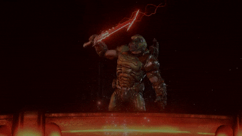

<h1 align="center">melvin@github:~$ whoami</h1>

  

  <b>Software Engineering Student • Developer • Fiji 🇫🇯</b>

---

## 👨‍💻 About Me

<pre>
melvin@github:~$ cat about_me.txt

Name       : Melvin A. Gounder
Role       : Software Engineering Student
Location   : Fiji 🇫🇯
Focus      : Software Development
Learning   : Java | Spring Boot | Cloud | Networking
Status     : Building...
</pre>

---

## 🌐 Connect With Me

  
  
  
  

---

## ⚙️ Tech Stack

  

---

## 🚀 Featured Projects

> A few things I've been building and learning from.

| Project | Description | Explore |
| :--- | :--- | :--- |
| 💻 **C++ Beginner Codes** | Beginner C++ exercises covering calculations, conditionals, and programming fundamentals. | [View code](https://github.com/Melvin-Gounder/cpp_beginners_codes) |
| 🎮 **Browser DOOM** | A browser-playable DOOM break between commits. | [Play DOOM](https://melvin-gounder.github.io/doom-web/) |

  <a href="https://github.com/Melvin-Gounder?tab=repositories">
    <b>Explore all my repositories →</b>
  </a>

---

## 📊 GitHub Stats & Languages

  

  Updated daily with GitHub Actions.

---

## 🐍 Contribution Activity

  <picture>
    <source
      media="(prefers-color-scheme: dark)"
      srcset="https://raw.githubusercontent.com/Melvin-Gounder/Melvin-Gounder/gh-pages/github-snake-dark.svg"
    />
    <source
      media="(prefers-color-scheme: light)"
      srcset="https://raw.githubusercontent.com/Melvin-Gounder/Melvin-Gounder/gh-pages/github-snake.svg"
    />
    
  </picture>

---

## 🎵 Spotify

  

---

## 🎮 DOOM Break

  <b>Waiting for a build? Bored between commits?</b> 
  Click below and play DOOM.

  

  <i>Click the animation to launch browser-playable DOOM.</i>

---

  <code>melvin@github:~$ exit</code> 
  Learning. Building. Improving.

